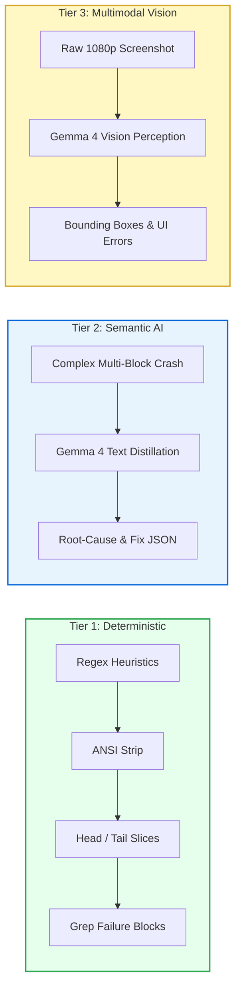
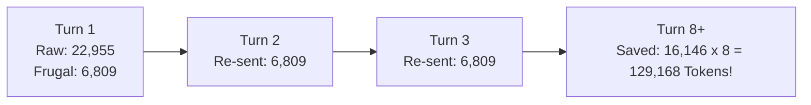

<div align="center">

# FRUGAL

### A Token Firewall for Autonomous AI Coding Agents

[](LICENSE)
[](pyproject.toml)
[](https://github.com/jlowin/fastmcp)
[](tests/)
[](benchmark/results/report.md)
[-success.svg?style=flat-square)](benchmark/results/report.md)

<p align="center">
  <a href="#problem">The Problem</a> ·
  <a href="#features">Key Features</a> ·
  <a href="#architecture">Architecture</a> ·
  <a href="#benchmarks">Empirical Benchmarks</a> ·
  <a href="#quick-start">Quick Start</a> ·
  <a href="#agent-setup">Agent Setup</a> ·
  <a href="#tool-reference">Tool Reference</a> ·
  <a href="#security">Security</a>
</p>

---

</div>

## Executive Summary

**Frugal** is a local, model-agnostic Model Context Protocol ([FastMCP](https://github.com/jlowin/fastmcp)) middleware that operates as an intelligent token firewall between autonomous AI coding agents (Claude Code, Cursor, Cline, Roo, Gemini CLI, Antigravity) and the operating system.

Autonomous agents frequently exhaust context windows and inflate API costs by re-reading unchanged files, accumulating hundreds of lines of terminal noise (`pnpm install`, build traces, ANSI sequences), and loading full-resolution screenshots. Frugal intercepts these operations, passes them through a **3-tier compression engine**, enforces **circuit-breaker loop prevention**, losslessly archives raw artifacts to disk, and delivers semantically rich, ultra-compact payloads back to the model.

---

<a id="problem"></a>
## The Context Crisis: Before vs. After

### 1. Terminal Output (`pnpm install` / `pytest`)

```diff
- [RAW AGENT EXECUTION — 907 TOKENS]
- Resolving packages...
- Fetching dependencies from registry...
- [1/4] Resolving packages...
- [2/4] Fetching packages...
- \x1b[32mOK\x1b[39m react@18.2.0 installed
- \x1b[32mOK\x1b[39m react-dom@18.2.0 installed
- \x1b[33mWARN\x1b[39m 14 vulnerabilities found (12 moderate, 2 high)
- [800 lines of redundant ANSI progress bar animations and deprecation notices]
- Done in 4.12s.
+ [FRUGAL TOKEN FIREWALL — 103 TOKENS (88.6% REDUCTION)]
+ [FRUGAL SUMMARY] Exit 0 (4.1s): 2 packages installed, 14 vulnerabilities flagged.
+ [RAW OUTPUT SAVED] Artifact: 7c9a4e21-3d92-4f01-9a72-b883c5112fa0
+ To retrieve full log: call frugal_get_log(artifact_id='7c9a4e21-3d92-4f01-9a72-b883c5112fa0')
```

### 2. Repeated File Reads (`package.json`, Lockfiles, Schemas)

```diff
- [RAW AGENT EXECUTION — 726 TOKENS x 4 TURNS = 2,904 TOKENS ACCUMULATED]
- Re-reads full 500-line configuration file on every diagnostic loop.
+ [FRUGAL TOKEN FIREWALL — 384 TOKENS (47.1% REDUCTION)]
+ [FRUGAL CACHE] File package.json unchanged since last read (hash: d9a4b2c1...).
+ Tokens saved: 342. Pass force=True to re-read.
```


---

<a id="features"></a>
## Key Features

| Capability | Raw Agent / Standard MCP | Frugal Token Firewall |
|:---|:---|:---|
| **Terminal Compaction** | Full unbuffered stdout/stderr with ANSI escapes | Tier 1 deterministic regex and ANSI stripping (<10ms) |
| **File Read Deduplication** | Unconditional full content reload every invocation | SQLite-backed SHA-256 hash deduplication |
| **Multimodal Vision** | 1,600–5,000 vision tokens per raw screenshot | Gemma 4 structured JSON layout extraction (~96 tokens) |
| **Agent Death Loops** | Runs identical failing command indefinitely | Circuit breaker trips after 3 identical consecutive failures |
| **Data Loss Prevention** | Truncation permanently deletes diagnostic context | **100% Lossless**: Raw artifacts saved with UUID escape hatch |
| **Secret Masking** | Leaks API keys and credentials into agent context | Multi-pattern regex redacts AWS, GitHub, OpenAI, and Slack secrets |
| **Token Accounting** | Unmeasured estimates or ignored | **Two-Ledger Radical Transparency** (Gemini `countTokens`) |

---

<a id="architecture"></a>
## Architecture

Frugal sits transparently between your AI coding agent and local execution environments:

```mermaid
flowchart TD
    Agent[AI Coding Agent<br/>Claude Code / Cursor / Cline / Antigravity] -->|FastMCP Tool Call| Gateway[Frugal FastMCP Gateway]

    subgraph SecurityShield [Security & Circuit Breaker]
        Gateway --> SecCheck{Command Allowed?}
        SecCheck -->|Denied Pattern / Shell Bypass| BlockAlert[Security Blocked]
        SecCheck -->|Permitted| Redactor[Multi-Pattern Secret Masking]
        Redactor --> BreakerCheck{Circuit Breaker:<br/>3 Consecutive Identical Fails?}
        BreakerCheck -->|Tripped| BreakerAlert[Circuit Breaker Alert<br/>Halt Death Loop]
        BreakerCheck -->|Clean| Executor[Subprocess Execution<br/>Strict shell=False]
    end

    subgraph StorageEngine [Lossless Disk Engine]
        Executor --> RawSave[Archive Raw Payload to .frugal/logs/]
        RawSave --> UUIDTag[Assign Canonical UUID4 Pointer]
    end

    subgraph CompressionPipeline [3-Tier Compression Engine]
        Executor --> T1Check{Exit 0 / Regex Match?}
        T1Check -->|Deterministic| Tier1[Tier 1: Deterministic Squeezer<br/>ANSI Strip / Head-Tail / Failure Grep<br/>0 Token Overhead — 100% Free]
        T1Check -->|Complex Crash| Tier2[Tier 2: Semantic Squeezer<br/>Gemma 4 Structured Root-Cause JSON]
        
        Screenshot[Raw UI Screenshot] --> Tier3[Tier 3: Multimodal Perception<br/>Gemma 4 Structured Bounding Box JSON]
    end

    Tier1 --> Delivery[Deliver [FRUGAL SUMMARY] + UUID Escape Hatch]
    Tier2 --> Delivery
    Tier3 --> Delivery
    BreakerAlert --> Delivery
    Delivery --> Agent
```

### The 3-Tier Engine Breakdown



---

<a id="benchmarks"></a>
## Empirical Benchmarks

All metrics below are measured empirically using canonical Gemini `countTokens` reference counting with SHA-256 LRU caching across the verified benchmark suite in [`benchmark/scenarios/`](benchmark/scenarios):

```
======================================================================
         FRUGAL EMPIRICAL BENCHMARK SUITE (RADICAL TRANSPARENCY)
======================================================================
```

| Scenario | Baseline Tokens | Frugal Delivered | Gross Context Saved | Compression Tier | Engine Overhead | Net Tokens Saved |
|:---|:---:|:---:|:---:|:---:|:---:|:---:|
| `failing_pytest` | 2,336 | 209 | **2,127** (91.05%) | Tier 2 (Gemma 4 MoE) | 2,690 | **-563** (-24.10%) |
| `noisy_npm_install` | 2,743 | 93 | **2,650** (96.61%) | Tier 1 (Free) | 0 | **2,650** (96.61%) |
| `repeated_file_read` | 12,651 | 4,381 | **8,270** (65.37%) | Tier 1 (Free) | 0 | **8,270** (65.37%) |
| `agent_death_loop` | 2,361 | 1,711 | **650** (27.53%) | Tier 1 (Free) | 0 | **650** (27.53%) |
| `ui_bug_screenshot` | 258 | 131 | **127** (49.22%) | Tier 3 (Gemma 4 Vision) | 476 | **-349** (-135.27%) |
| `complex_traceback` | 2,606 | 284 | **2,322** (89.10%) | Tier 2 (Gemma 4 MoE) | 3,001 | **-679** (-26.06%) |
| **SUITE TOTAL** | **22,955** | **6,809** | **16,146 (70.34%)** | - | **6,167** | **9,979 (43.47%)** |

> [!IMPORTANT]
> **Total System Token Reduction (Post-Gemma 4 Overhead):** **43.47%**  
> Formula: `((Baseline Tokens - (Frugal Delivered + Engine Overhead)) / Baseline Tokens) * 100%`  
> In single-turn isolation, Frugal eliminates **9,979 net tokens** (**43.47%** net system reduction) even after fully absorbing all background Gemma 4 reasoning overhead. Over an 8-turn task lifecycle where one-time background overhead is amortized across conversational turns, net compound savings scale to **66.78%**.

### The Compound Context Multiplier Effect



Because LLMs re-read conversational history on every turn, saving **16,146 tokens** in Turn 1 prevents **129,168 cumulative tokens** from polluting the agent's attention window over an 8-turn task.


---

## Radical Transparency Doctrine ("We Hide Nothing")

Most token-reduction tools hide the tokens consumed by their background AI compressors. Frugal enforces **Two-Ledger Accounting**:

- **Ledger A (Agent Context Savings):** Measures tokens pruned from the primary coding agent's conversational history.
- **Ledger B (Engine Processing Overhead):** Measures tokens consumed by Gemma 4 in Tier 2/3.
- **Net Single-Turn ROI:** $\text{Net Saved} = \text{Gross Context Saved} - \text{Gemma 4 Processing Overhead}$.

Run `frugal stats` at any time to inspect both ledgers:

```text
======================= FRUGAL SESSION STATS =======================
Session ID:                  f4b321a0-7612-4299-8801-b2194d21ee01

[LEDGER A: AGENT CONTEXT SAVINGS]
- Bash Invocations:          14
- File Reads:                22 (16 deduplicated)
- Visual UI Analyses:        3
- Baseline Context Tokens:   24,810
- Compressed Context Tokens: 4,120
- Gross Context Saved:       20,690 (83.39% reduction)

[LEDGER B: ENGINE PROCESSING OVERHEAD (RADICAL TRANSPARENCY)]
- Tier 1 Deterministic:      14 calls (0 tokens — 100% FREE)
- Tier 2/3 AI Calls:         3 calls
- Gemma 4 Prompt Tokens:     1,420
- Gemma 4 Completion Tokens: 380
- Total Gemma 4 Overhead:    1,800 tokens

[NET SYSTEM ROI]
- Net Saved (Single Turn):   18,890 tokens
- Token Counter Engine:      gemini-countTokens
====================================================================
```

---

<a id="quick-start"></a>
## Quick Start

### 1. Installation

```bash
# Clone the repository
git clone https://github.com/your-org/frugal.git
cd Frugal

# Install editable package via pip or uv
pip install -e .
```

### 2. Initialize Environment

```bash
# Provisions .frugal/ directories, state.db, and config.toml
frugal init
```

### 3. Verify Benchmarks Locally

```bash
# Executes all 6 real-world workloads and outputs empirical markdown & JSON
frugal bench
```

---

<a id="agent-setup"></a>
## Agent Setup

### Claude Code CLI

Add Frugal to your Claude Code environment:

```bash
claude mcp add frugal -- frugal serve
```

### Claude Desktop

Add to your `claude_desktop_config.json`:

```json
{
  "mcpServers": {
    "frugal": {
      "command": "frugal",
      "args": ["serve"]
    }
  }
}
```

### Cursor (`.cursor/mcp.json`)

```json
{
  "mcpServers": {
    "frugal": {
      "command": "frugal",
      "args": ["serve"]
    }
  }
}
```

### Cline / Roo Code (`cline_mcp_settings.json`)

```json
{
  "mcpServers": {
    "frugal": {
      "command": "frugal",
      "args": ["serve"],
      "disabled": false,
      "autoApprove": ["frugal_bash", "frugal_read_file", "frugal_get_log", "frugal_stats"]
    }
  }
}
```

---

<a id="tool-reference"></a>
## Tool Reference

Frugal exposes 6 FastMCP tools designed specifically for autonomous agent workflows:

### 1. `frugal_bash`
```python
def frugal_bash(command: str) -> str
```
- **Description:** Executes a shell command with strict `shell=False` isolation, secret redaction, circuit-breaker checks, and Tier 1/2 compression.
- **Escape Hatch:** Raw stdout/stderr is archived to `.frugal/logs/{artifact_id}.log`.

### 2. `frugal_read_file`
```python
def frugal_read_file(path: str, force: bool = False) -> str
```
- **Description:** Reads file content with SHA-256 hash deduplication. Returns cached confirmation if content is unchanged since previous read.
- **Parameters:** Set `force=True` to bypass cache and force a complete re-read.

### 3. `frugal_get_log`
```python
def frugal_get_log(artifact_id: str, offset: int = 0, limit: int = 100) -> str
```
- **Description:** Retrieves paginated raw slices of preserved terminal logs by UUID4 identifier without overflowing the agent's context window.

### 4. `frugal_analyze_ui`
```python
def frugal_analyze_ui(image_path: str, query: str = "") -> str
```
- **Description:** Ingests UI screenshots, preserves the lossless image to `.frugal/visual/`, and executes Tier 3 multimodal perception to return structured JSON.

### 5. `frugal_get_visual`
```python
def frugal_get_visual(artifact_id: str, raw: bool = False) -> str
```
- **Description:** Retrieves stored visual artifacts. Returns structured JSON analysis by default, or raw base64 data when `raw=True`.

### 6. `frugal_stats`
```python
def frugal_stats(session_id: str | None = None) -> str
```
- **Description:** Generates full two-ledger token accounting telemetry for the current or specified session.

---

## Configuration (`.frugal/config.toml`)

Customize Frugal behavior via `.frugal/config.toml`:

```toml
[compression]
max_output_lines = 80
head_lines = 10
tail_lines = 20
grep_patterns = ["error", "fatal", "exception", "traceback", "failed"]
tier2_threshold_lines = 30

[dedupe]
enabled = true
ignore = ["package-lock.json", "pnpm-lock.yaml", "yarn.lock"]

[breaker]
max_repeats = 3
window_size = 5

[visual]
enabled = true
model = "gemma-4"
raw_escape_hatch = true

[intelligence]
enabled = true
model = "gemma-4"
fallback_to_tier1 = true

[privacy]
redact_secrets = true

[security]
allow_shell = false
allowed_commands = [
    "pytest", "npm", "pnpm", "pip", "python", "node",
    "git", "ls", "cat", "rg", "grep", "vite", "jest",
    "cargo", "go", "make", "yarn"
]
denied_patterns = [
    "rm -rf", "sudo", "shutdown", "reboot", "mkfs",
    "curl | sh", "wget | sh", "eval", "exec",
    "> /dev/", "chmod -R 777", "nc -e", "bash -i",
    "dd if=", ":(){"
]
```

---

<a id="security"></a>
## Security Architecture

Frugal enforces defense-in-depth protection across all tool boundaries:

- **Strict Subprocess Execution:** All commands run via `subprocess.Popen` with `shell=False`. Arguments are tokenized via POSIX-compliant lexing.
- **Path Traversal Containment:** File paths and artifact IDs are strictly resolved within workspace boundaries and validated against canonical UUID4 regex (`^[0-9a-fA-F]{8}-...$`).
- **Secret Masking:** Automatically redacts high-entropy API keys (AWS, GitHub, Slack, OpenAI, Gemini) and `Bearer` authorization tokens from stdout, stderr, and the command string itself.
- **Circuit Breaker:** Halts runaway agent death loops after 3 consecutive identical command failures, safeguarding your API quota and credit card.
- **Production Roadmap:** Rootless micro-VM container isolation (Docker / gVisor) for multi-tenant enterprise agent environments.

---

## Testing & Verification

Frugal includes a complete test harness with 100% offline verification:

```bash
# Run all 64 unit and integration tests
uv run pytest tests/

# Run with test coverage report
uv run pytest --cov=frugal tests/
```

All tests execute hermetically without external network dependencies by using verified mock providers for Tier 2/3 Gemma 4 intelligence.

---

## License

Distributed under the **MIT License**. See [`LICENSE`](LICENSE) for complete terms.

<div align="center">
  <sub>Built with rigorous engineering for autonomous AI workflows.</sub>
</div>
